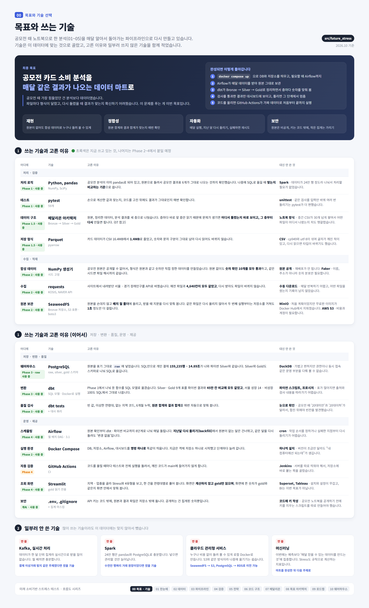
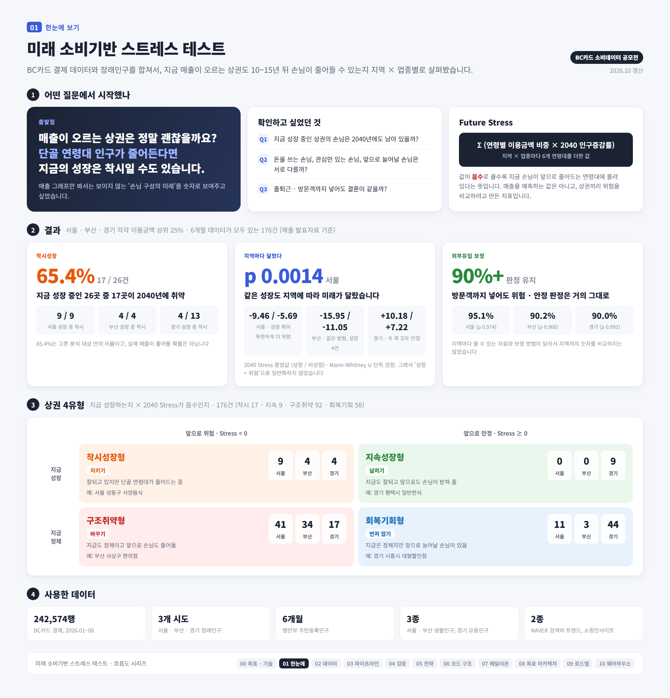
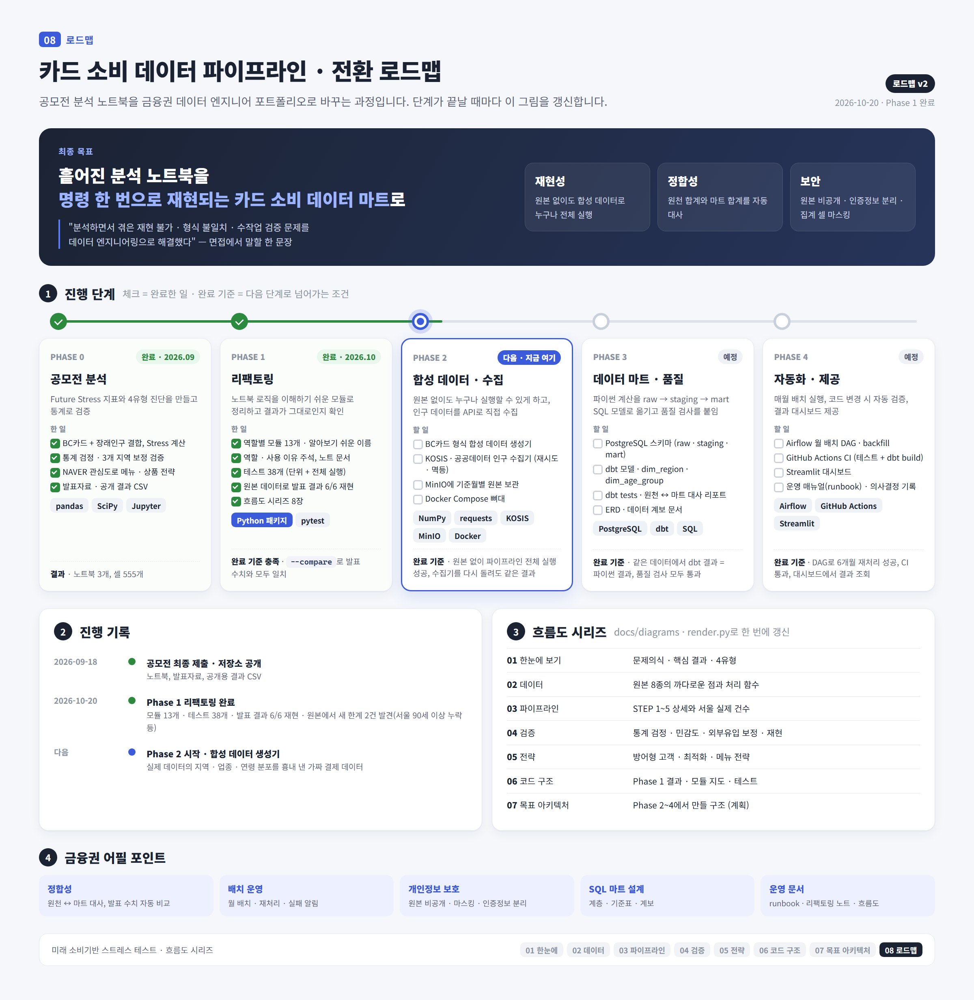

# 미래 소비기반 스트레스 테스트

현재 매출이 성장하는 상권도 핵심 소비연령의 인구가 감소하면 미래 소비기반이 약해질 수 있습니다. 이 프로젝트는 BC Card 결제 데이터와 장래인구, NAVER 관심도 자료를 결합해 지역과 업종별 미래 구조위험을 진단하고 유형별 고객 및 상품 전략을 제안합니다.

## 포트폴리오 목표와 기술 선택

공모전 분석을 **금융권 데이터 엔지니어 포트폴리오**로 확장하고 있습니다. 최종 목적은 이 분석을 매월 자동으로 수집 · 적재 · 검증 · 제공되는 데이터 마트 파이프라인으로 만드는 것이고, 기술마다 선택한 이유와 일부러 쓰지 않은 기술을 함께 정리했습니다.



## 한눈에 보기



## 흐름도 시리즈

주제별로 나눈 흐름도입니다. 프로젝트 단계가 끝날 때마다 갱신합니다 (`docs/diagrams/*.html` 수정 후 `render.py` 실행).

| # | 흐름도 | 내용 |
|---|---|---|
| 00 | [목표 · 기술 선택](docs/diagrams/00_goal_and_stack.png) | 최종 목적, 기술 스택과 선택 이유, 쓰지 않는 기술, 보여줄 역량 |
| 01 | [한눈에 보기](docs/diagrams/01_overview.png) | 문제의식, 핵심 결과, 4유형 |
| 02 | [데이터](docs/diagrams/02_data.png) | 원본 8종의 까다로운 점과 처리 함수, 표준화 기준표 |
| 03 | [분석 파이프라인](docs/diagrams/03_pipeline.png) | STEP 1~5 상세와 서울 실제 건수 |
| 04 | [검증](docs/diagrams/04_validation.png) | 통계 검정, 규모 민감도, 외부유입 보정, 재현 검증 |
| 05 | [전략](docs/diagrams/05_strategy.png) | 방어형 고객, 고객 구성 최적화, 메뉴 · 상품 전략 |
| 06 | [코드 구조](docs/diagrams/06_code_structure.png) | Phase 1 리팩토링 결과, 모듈 지도, 테스트 |
| 07 | [목표 아키텍처](docs/diagrams/07_target_architecture.png) | Phase 2~4에서 만들 데이터 마트 구조 (계획) |
| 08 | [로드맵](docs/diagrams/08_roadmap.png) | 단계별 할 일과 완료 기준, 진행 기록 |

## 포트폴리오 전환 로드맵

공모전 분석을 금융권 데이터 엔지니어링 포트폴리오로 확장하고 있습니다.



| 단계 | 내용 | 상태 |
|---|---|---|
| Phase 0 | 공모전 분석 (노트북) | 완료 |
| Phase 1 | 리팩토링: 노트북 → `src/future_stress` 모듈 + 테스트, 발표 결과 6/6 재현 ([리팩토링 노트](docs/refactoring_notes.md)) | 완료 |
| Phase 2 | 합성 데이터 · 공공 API 수집 | 다음 |
| Phase 3 | PostgreSQL + dbt 데이터 마트 · 품질 검사 | 예정 |
| Phase 4 | Airflow 배치 · CI · 대시보드 | 예정 |

## 분석 질문

- 현재 성장 중인 상권의 소비기반은 2040년에도 유지되는가?
- 결제 고객과 관심 고객, 미래 고객은 어떻게 다른가?
- 생활인구 또는 유동인구를 반영해도 기존 진단과 위험순위가 유지되는가?

## 분석 흐름

1. BC Card 2026년 1월부터 6월까지의 결제 데이터를 지역, 업종, 연령 단위로 집계합니다.
2. 6개월 완전 사례와 지역별 이용금액 상위 25%를 선정합니다.
3. 월평균증감률, 1월 대비 6월 변화, 상승개월수로 현재 성장을 판정합니다.
4. 연령별 이용금액 비중과 2040년 인구증감률을 결합해 Future Stress를 계산합니다.
5. 현재 성장 여부와 Future Stress 부호를 결합해 네 가지 상권 유형을 분류합니다.
6. NAVER Search와 Shopping Insight로 관심 고객과 상품 후보를 해석합니다.
7. 지역별 외부유입 자료로 분류 일치율과 Spearman 순위 상관을 확인합니다.

## 핵심 공식

```text
Future Stress = Σ(연령별 이용금액 비중 × 2040년 인구증감률)
```

Future Stress가 음수이면 현재 소비구조가 미래 인구감소에 더 많이 노출된 것으로 해석합니다. 이 지표는 미래 매출액 예측값이 아니라 소비기반의 상대적 구조위험을 진단하는 지표입니다.

## 네 가지 진단 유형

| 현재 성장 | Future Stress | 유형 | 전략 방향 |
|---|---:|---|---|
| 성장 | 취약 | 착시성장형 | 방어 |
| 성장 | 안정 | 지속성장형 | 확장 |
| 비성장 | 취약 | 구조취약형 | 재편 |
| 비성장 | 안정 | 회복기회형 | 선점 |

## 검증 방법

- Mann-Whitney U 검정으로 성장군과 비성장군의 Stress 분포 차이를 확인했습니다.
- Spearman 상관계수로 외부유입 보정 전후의 위험순위가 유지되는지 확인했습니다.
- 위험과 안정의 부호가 같은 사례 비율을 분류 일치율로 계산했습니다.

서울, 부산, 경기는 외부유입 데이터의 기간과 구조, 보정 방식이 다릅니다. 각 지역 안에서 원본과 보정 결과를 비교했으며 지역 간 수치를 직접 비교하지 않습니다.

## 결과 예시


## 기술 스택

선택 이유는 [00 목표 · 기술 선택](docs/diagrams/00_goal_and_stack.png)에 정리했습니다.

| 구분 | 기술 | 상태 |
|---|---|---|
| 처리 · 분석 | Python, pandas, NumPy, SciPy | 사용 중 |
| 테스트 | pytest | 사용 중 |
| 수집 | requests (KOSIS · NAVER API), 합성 데이터 생성기 | Phase 2 |
| 원본 보관 | MinIO (S3 호환) | Phase 2 |
| 저장 · 변환 · 품질 | PostgreSQL, dbt, dbt tests | Phase 3 |
| 운영 · 제공 | Airflow, Docker Compose, GitHub Actions, Streamlit | Phase 2 ~ 4 |

## 실행 방법

Windows PowerShell 기준입니다. 저장소 폴더에서 한 줄씩 실행합니다.

```powershell
python -m venv .venv
```

```powershell
.venv\Scripts\python -m pip install -e ".[dev]"
```

```powershell
.venv\Scripts\python -m pytest
```

원본 데이터를 `data/raw/`에 넣었다면 전체 분석을 실행하고 발표 수치와 비교할 수 있습니다.

```powershell
.venv\Scripts\python -m future_stress.pipeline --compare
```

## 저장소 구성

```text
src/          분석 로직 패키지 (future_stress)
tests/        단위 테스트와 전체 실행 테스트
notebooks/    실행 출력과 인증정보를 제거한 원래 분석 노트북 (보존용)
assets/       포트폴리오용 결과 이미지
docs/         최종 발표자료, 흐름도 시리즈(diagrams/), 리팩토링 노트
data/         데이터 비공개 사유와 재현 안내
results/      발표자료에 사용한 소규모 집계 결과 CSV
scripts/      공개용 노트북 정리 스크립트
```

## 데이터 공개 범위

공모전에서 제공한 BC Card 원본과 상세 파생 데이터는 저장소에 포함하지 않습니다. `results`에는 발표자료에 이미 제시한 집계 결과만 포함합니다. 서울, 부산, 경기의 외부 데이터도 원본 파일 대신 출처와 처리 방식을 문서화합니다. 노트북 실행에는 사용 권한이 있는 원본 데이터와 NAVER API 인증정보가 필요합니다.

## 공개한 결과 CSV

- 성장군과 비성장군의 Stress 비교
- 지역별 외부유입 민감도 검증 요약
- 규모 기준 민감도 검증
- 통계 검정 결과
- 대표 사례와 4유형 고객 전략

## 발표자료

- [최종 발표자료](docs/bc_card_future_consumer_stress.pptx)
