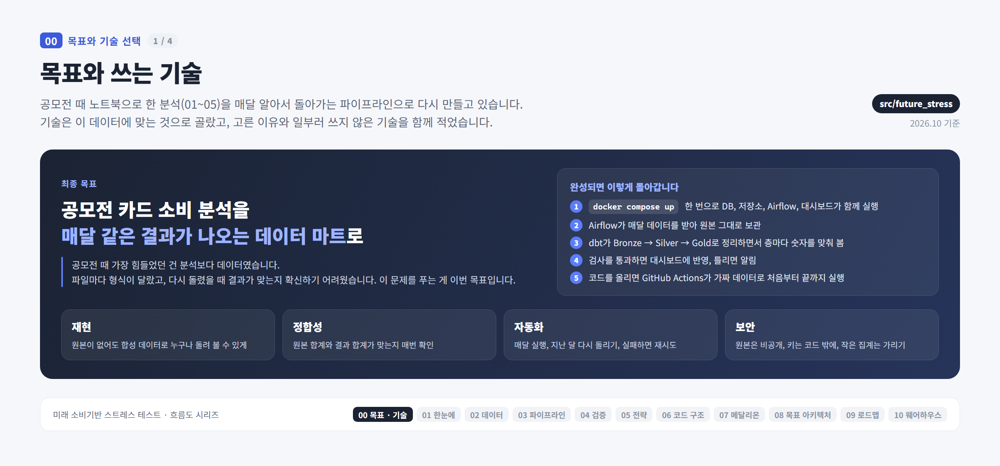
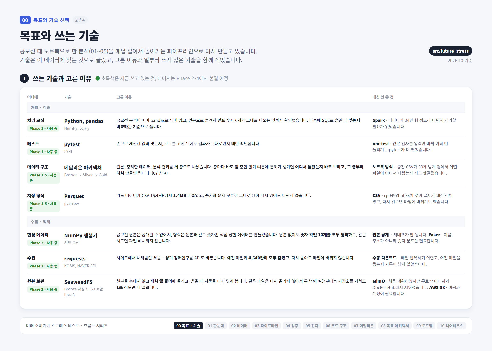
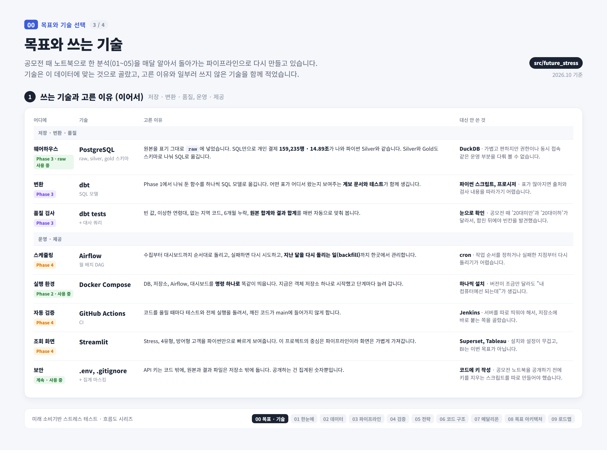
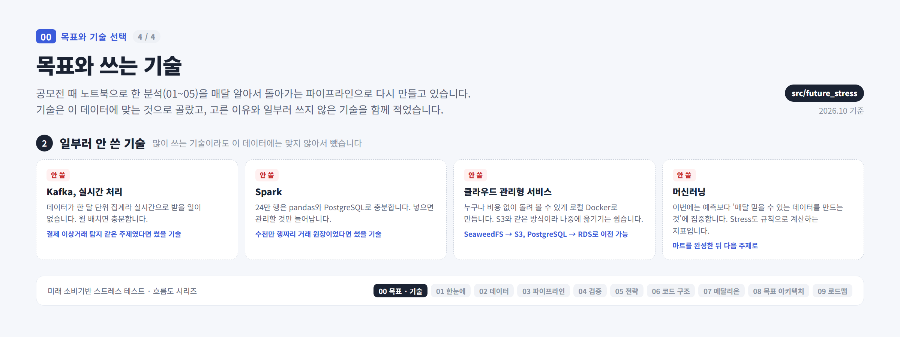
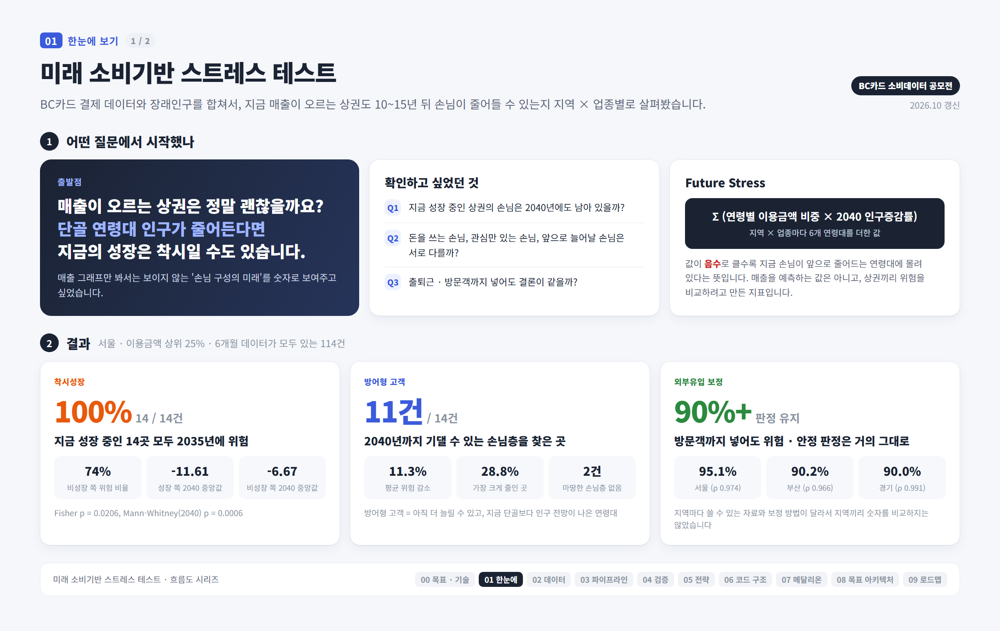
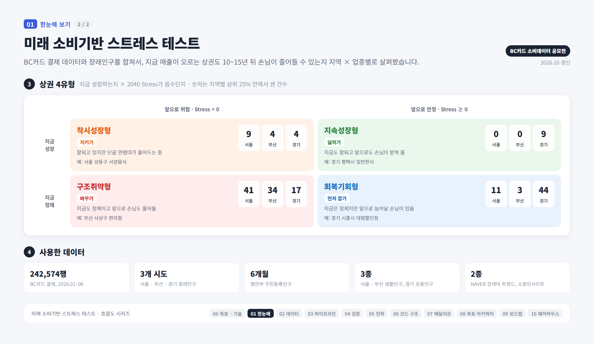
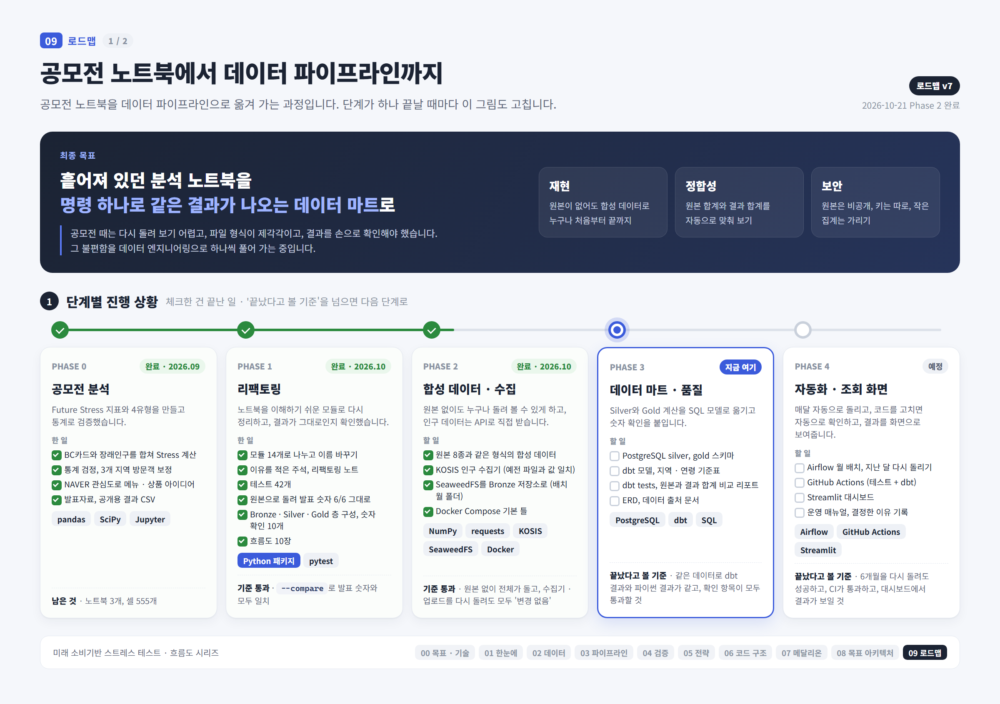
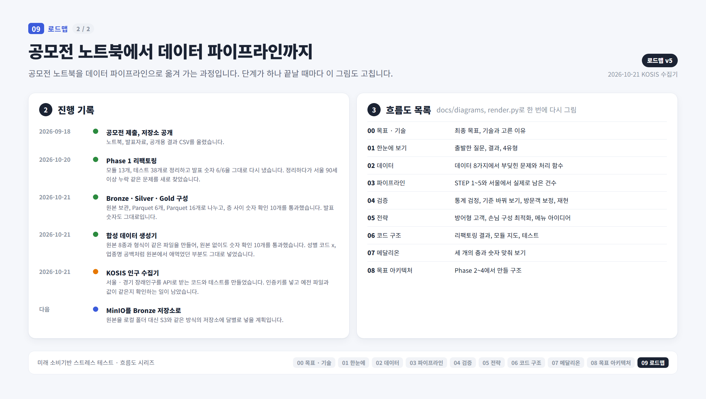
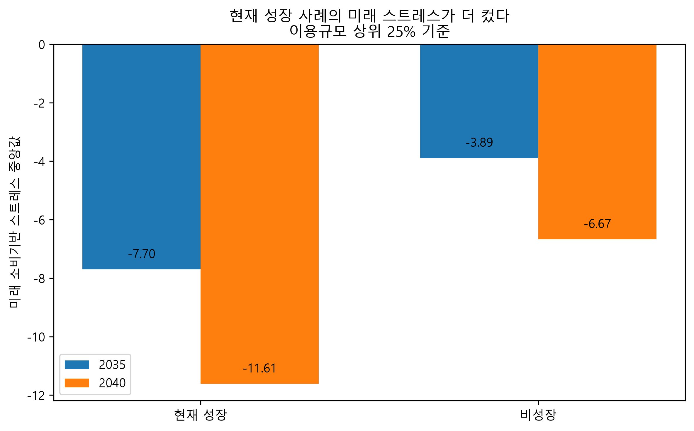
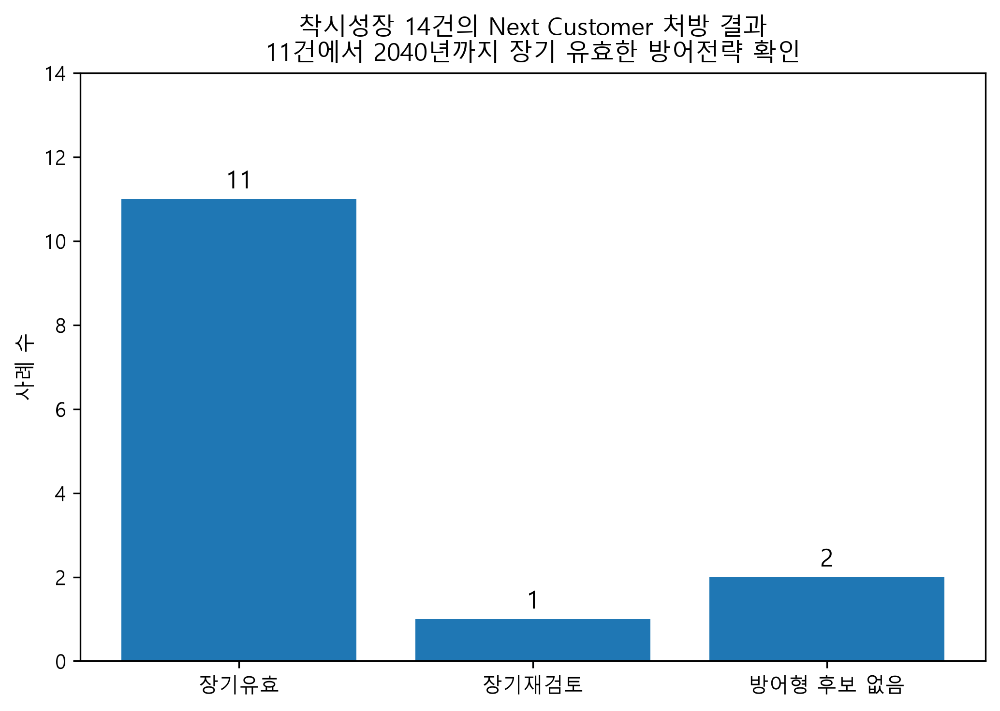

# 미래 소비기반 스트레스 테스트

현재 매출이 성장하는 상권도 핵심 소비연령의 인구가 감소하면 미래 소비기반이 약해질 수 있습니다. 이 프로젝트는 BC Card 결제 데이터와 장래인구, NAVER 관심도 자료를 결합해 지역과 업종별 미래 구조위험을 진단하고 유형별 고객 및 상품 전략을 제안합니다.

## 목표와 쓰는 기술

공모전 때 노트북으로 한 분석을 매달 수집 · 정리 · 검증 · 조회까지 자동으로 돌아가는 데이터 파이프라인으로 다시 만들고 있습니다. 기술마다 고른 이유와 일부러 쓰지 않은 기술을 함께 정리했습니다.









## 한눈에 보기





## 흐름도 시리즈

주제별로 나눈 흐름도입니다. 프로젝트 단계가 끝날 때마다 갱신합니다 (`docs/diagrams/*.html` 수정 후 `render.py` 실행).
'나눠 보기'는 게시용으로 2~4장씩 나눈 그림이고(`docs/diagrams/parts/`), 전체 한 장은 보관 · 전체 보기용입니다.

| # | 흐름도 (전체 한 장) | 나눠 보기 | 내용 |
|---|---|---|---|
| 00 | [목표 · 기술 선택](docs/diagrams/00_goal_and_stack.png) | [1](docs/diagrams/parts/00_goal_and_stack_1.png) · [2](docs/diagrams/parts/00_goal_and_stack_2.png) · [3](docs/diagrams/parts/00_goal_and_stack_3.png) · [4](docs/diagrams/parts/00_goal_and_stack_4.png) | 최종 목적, 기술 스택과 선택 이유, 쓰지 않는 기술, 보여줄 역량 |
| 01 | [한눈에 보기](docs/diagrams/01_overview.png) | [1](docs/diagrams/parts/01_overview_1.png) · [2](docs/diagrams/parts/01_overview_2.png) | 문제의식, 핵심 결과, 4유형 |
| 02 | [데이터](docs/diagrams/02_data.png) | [1](docs/diagrams/parts/02_data_1.png) · [2](docs/diagrams/parts/02_data_2.png) · [3](docs/diagrams/parts/02_data_3.png) | 원본 8종의 까다로운 점과 처리 함수, 표준화 기준표 |
| 03 | [분석 파이프라인](docs/diagrams/03_pipeline.png) | [1](docs/diagrams/parts/03_pipeline_1.png) · [2](docs/diagrams/parts/03_pipeline_2.png) · [3](docs/diagrams/parts/03_pipeline_3.png) | STEP 1~5 상세와 서울 실제 건수 |
| 04 | [검증](docs/diagrams/04_validation.png) | [1](docs/diagrams/parts/04_validation_1.png) · [2](docs/diagrams/parts/04_validation_2.png) | 통계 검정, 규모 민감도, 외부유입 보정, 재현 검증 |
| 05 | [전략](docs/diagrams/05_strategy.png) | [1](docs/diagrams/parts/05_strategy_1.png) · [2](docs/diagrams/parts/05_strategy_2.png) · [3](docs/diagrams/parts/05_strategy_3.png) | 방어형 고객, 고객 구성 최적화, 메뉴 · 상품 전략 |
| 06 | [코드 구조](docs/diagrams/06_code_structure.png) | [1](docs/diagrams/parts/06_code_structure_1.png) · [2](docs/diagrams/parts/06_code_structure_2.png) · [3](docs/diagrams/parts/06_code_structure_3.png) | Phase 1 리팩토링 결과, 모듈 지도, 테스트 |
| 07 | [메달리온 아키텍처](docs/diagrams/07_medallion.png) | [1](docs/diagrams/parts/07_medallion_1.png) · [2](docs/diagrams/parts/07_medallion_2.png) · [3](docs/diagrams/parts/07_medallion_3.png) | Bronze → Silver → Gold 계층, 계층 사이 대사 |
| 08 | [목표 아키텍처](docs/diagrams/08_target_architecture.png) | [1](docs/diagrams/parts/08_target_architecture_1.png) · [2](docs/diagrams/parts/08_target_architecture_2.png) · [3](docs/diagrams/parts/08_target_architecture_3.png) | Phase 2~4에서 만들 데이터 마트 구조 (계획) |
| 09 | [로드맵](docs/diagrams/09_roadmap.png) | [1](docs/diagrams/parts/09_roadmap_1.png) · [2](docs/diagrams/parts/09_roadmap_2.png) | 단계별 할 일과 완료 기준, 진행 기록 |

## 로드맵

공모전 노트북을 데이터 파이프라인으로 옮겨 가는 과정입니다.





| 단계 | 내용 | 상태 |
|---|---|---|
| Phase 0 | 공모전 분석 (노트북) | 완료 |
| Phase 1 | 리팩토링: 노트북 → `src/future_stress` 모듈 + 테스트, 발표 결과 6/6 재현 ([리팩토링 노트](docs/refactoring_notes.md)) | 완료 |
| Phase 1.5 | 메달리온 아키텍처 로컬 세팅: Bronze → Silver → Gold, 계층 사이 대사 10개 | 완료 |
| Phase 2 | 합성 데이터 생성기 · KOSIS 수집기(파일과 값 일치 확인) · SeaweedFS Bronze 저장소 · Docker Compose | 완료 |
| Phase 3 | PostgreSQL + dbt 데이터 마트 · 품질 검사 (raw · Silver · Gold 완료, 문서 · ERD 다음) | 진행 중 |
| Phase 4 | Airflow 배치 · CI · 대시보드 | 예정 |

## 분석 질문

- 현재 성장 중인 상권의 소비기반은 2040년에도 유지되는가?
- 결제 고객과 관심 고객, 미래 고객은 어떻게 다른가?
- 생활인구 또는 유동인구를 반영해도 기존 진단과 위험순위가 유지되는가?

## 분석 흐름

1. BC Card 2026년 1월부터 6월까지의 결제 데이터를 지역, 업종, 연령 단위로 집계합니다.
2. 6개월 완전 사례와 지역별 이용금액 상위 25%를 선정합니다.
3. 월평균증감률, 1월 대비 6월 변화, 상승개월수로 현재 성장을 판정합니다.
4. 연령별 이용금액 비중과 2040년 인구증감률을 결합해 Future Stress를 계산합니다.
5. 현재 성장 여부와 Future Stress 부호를 결합해 네 가지 상권 유형을 분류합니다.
6. NAVER Search와 Shopping Insight로 관심 고객과 상품 후보를 해석합니다.
7. 지역별 외부유입 자료로 분류 일치율과 Spearman 순위 상관을 확인합니다.

## 핵심 공식

```text
Future Stress = Σ(연령별 이용금액 비중 × 2040년 인구증감률)
```

Future Stress가 음수이면 현재 소비구조가 미래 인구감소에 더 많이 노출된 것으로 해석합니다. 이 지표는 미래 매출액 예측값이 아니라 소비기반의 상대적 구조위험을 진단하는 지표입니다.

## 네 가지 진단 유형

| 현재 성장 | Future Stress | 유형 | 전략 방향 |
|---|---:|---|---|
| 성장 | 취약 | 착시성장형 | 방어 |
| 성장 | 안정 | 지속성장형 | 확장 |
| 비성장 | 취약 | 구조취약형 | 재편 |
| 비성장 | 안정 | 회복기회형 | 선점 |

## 검증 방법

- Mann-Whitney U 검정으로 성장군과 비성장군의 Stress 분포 차이를 확인했습니다.
- Spearman 상관계수로 외부유입 보정 전후의 위험순위가 유지되는지 확인했습니다.
- 위험과 안정의 부호가 같은 사례 비율을 분류 일치율로 계산했습니다.

서울, 부산, 경기는 외부유입 데이터의 기간과 구조, 보정 방식이 다릅니다. 각 지역 안에서 원본과 보정 결과를 비교했으며 지역 간 수치를 직접 비교하지 않습니다.

## 결과 예시





## 기술 스택

선택 이유는 [00 목표 · 기술 선택](docs/diagrams/00_goal_and_stack.png)에 정리했습니다. 기술마다 왜 골랐고 써 보니 무엇이 좋아졌는지는 [기술 · 설계 기록](docs/notes/README.md)에 주제별로 쌓고 있습니다 (메달리온, 품질 검사, 멱등성, 예외 처리, API 수집 등 13개 주제).

| 구분 | 기술 | 상태 |
|---|---|---|
| 처리 · 분석 | Python, pandas, NumPy, SciPy | 사용 중 |
| 데이터 구조 · 저장 | 메달리온 아키텍처 (Bronze · Silver · Gold), Parquet (pyarrow) | 사용 중 |
| 테스트 | pytest | 사용 중 |
| 합성 데이터 | NumPy 생성기 (원본 8종과 같은 형식, 시드 고정) | 사용 중 |
| 수집 | requests (KOSIS 장래인구 수집기 · NAVER API) | 사용 중 |
| 원본 보관 | SeaweedFS (S3 호환, boto3), Docker Compose | 사용 중 |
| 저장 · 변환 · 품질 | PostgreSQL (raw · silver · gold 스키마), dbt (Docker), dbt tests | 사용 중 |
| 운영 · 제공 | Airflow, GitHub Actions, Streamlit | Phase 4 |

## 실행 방법

Windows PowerShell 기준입니다. 저장소 폴더에서 한 줄씩 실행합니다.

```powershell
python -m venv .venv
```

```powershell
.venv\Scripts\python -m pip install -e ".[dev]"
```

```powershell
.venv\Scripts\python -m pytest
```

원본 데이터가 없어도 합성 데이터로 전체 과정을 돌려 볼 수 있습니다. 원본과 형식이 같은 파일을 `data/synthetic/raw/`에 만든 뒤, 같은 폴더 아래에 bronze · silver · gold · output을 만듭니다. 숫자는 직접 정한 값이라 발표 결과와는 다릅니다.

```powershell
.venv\Scripts\python -m future_stress.pipeline --synthetic
```

서울 · 경기 장래인구는 KOSIS API로 직접 받을 수 있습니다. 인증키는 저장소 루트의 `.env`에 `KOSIS_API_KEY=발급받은키`로 넣습니다 (`.env`는 git에 올라가지 않습니다). 받은 응답은 `data/raw/kosis/`에 연도별 JSON으로 저장되고, 두 번째 명령은 예전에 내려받은 파일 값과 같은지 비교합니다.

```powershell
.venv\Scripts\python -m future_stress.kosis collect
```

```powershell
.venv\Scripts\python -m future_stress.kosis compare
```

Docker로 로컬 서비스(객체 저장소 SeaweedFS, 데이터베이스 PostgreSQL)를 띄워 실행할 수도 있습니다. Docker Desktop이 필요합니다. 첫 줄은 처음 한 번만 실행하며, `.env`에 이 PC 전용 계정(저장소 키, DB 비밀번호)을 만듭니다.

```powershell
.venv\Scripts\python -m future_stress.local_env
```

```powershell
docker compose up -d
```

```powershell
.venv\Scripts\python -m future_stress.pipeline --object-store --warehouse
```

raw 스키마에 원본이 들어가면 dbt로 Silver · Gold를 만들고 테스트합니다. dbt도 Docker로 돌아서 따로 설치할 것이 없습니다. 아래 두 명령은 dbt 결과가 파이썬 Silver · Gold와 같은지 한 칸씩 비교합니다.

```powershell
docker compose run --rm dbt build
```

```powershell
.venv\Scripts\python -m future_stress.warehouse compare-silver
```

```powershell
.venv\Scripts\python -m future_stress.warehouse compare-gold
```

`--object-store`는 Bronze를 SeaweedFS에 올리고 거기서 다시 받아 실행하고, `--warehouse`는 원본을 PostgreSQL `raw` 스키마에도 적재합니다(둘 중 하나만 써도 됩니다). 원본이 없으면 `--synthetic`을 함께 붙이면 됩니다. 원본이 있으면 `--compare`를 붙여 발표 수치와 비교할 수 있습니다.

원본 데이터를 `data/raw/`에 넣었다면 전체 분석을 실행하고 발표 수치와 비교할 수 있습니다. 실행하면 `data/bronze` (원본 + 적재 영수증) → `data/silver` (정제 Parquet) → `data/gold` (분석 Parquet) 순서로 계층이 만들어지고, 계층 사이 건수 · 금액 대사를 통과해야 `output/`에 결과 CSV가 저장됩니다.

```powershell
.venv\Scripts\python -m future_stress.pipeline --compare
```

## 저장소 구성

```text
src/          분석 로직 패키지 (future_stress)
tests/        단위 테스트와 전체 실행 테스트
notebooks/    실행 출력과 인증정보를 제거한 원래 분석 노트북 (보존용)
assets/       발표에 쓴 결과 이미지
docs/         최종 발표자료, 흐름도 시리즈(diagrams/), 리팩토링 노트, 기술 · 설계 기록(notes/)
data/         데이터 비공개 사유와 재현 안내 (실행하면 raw · bronze · silver · gold · synthetic이 생기며 모두 git 제외)
results/      발표자료에 사용한 소규모 집계 결과 CSV
scripts/      공개용 노트북 정리 스크립트
```

## 데이터 공개 범위

공모전에서 제공한 BC Card 원본과 상세 파생 데이터는 저장소에 포함하지 않습니다. `results`에는 발표자료에 이미 제시한 집계 결과만 포함합니다. 서울, 부산, 경기의 외부 데이터도 원본 파일 대신 출처와 처리 방식을 문서화합니다. 노트북 실행에는 사용 권한이 있는 원본 데이터와 NAVER API 인증정보가 필요합니다.

## 공개한 결과 CSV

- 성장군과 비성장군의 Stress 비교
- 지역별 외부유입 민감도 검증 요약
- 규모 기준 민감도 검증
- 통계 검정 결과
- 대표 사례와 4유형 고객 전략

## 발표자료

- [최종 발표자료](docs/bc_card_future_consumer_stress.pptx)
