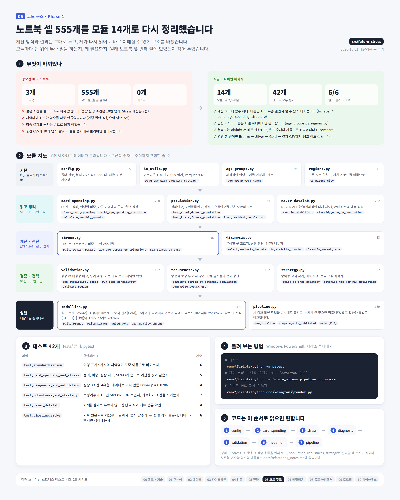
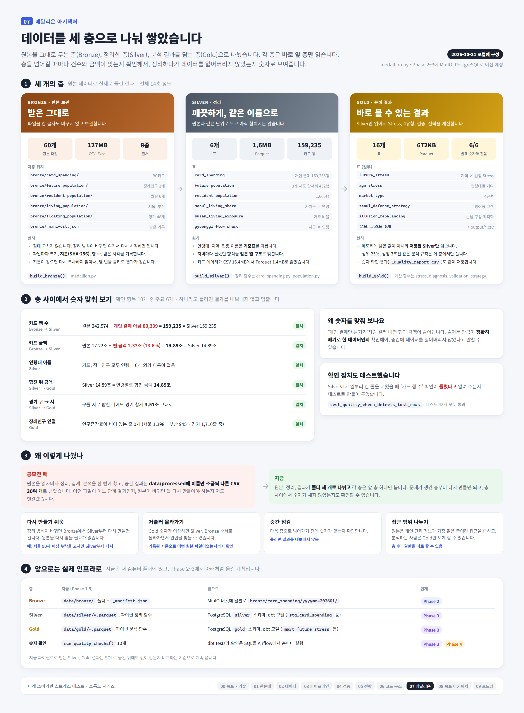

# 리팩토링 노트 (Phase 1)

공모전 노트북 3개(셀 555개)를 `src/future_stress/` 패키지로 옮기면서 바꾼 점과 발견한 문제를 정리한 문서입니다.
코드를 처음 읽을 때는 **흐름도(diagrams/03_pipeline.png, 06_code_structure.png) → 이 문서의 대응표 → 해당 함수의 주석** 순서로 보면 됩니다.



## 1. 폴더 구조

```text
src/future_stress/
  config.py          경로 · 분석 기간 · 판정 기준값 (숫자는 여기만 고치면 됨)
  io_utils.py        CSV 인코딩 자동 판별, 쉼표 숫자 변환, Parquet 저장 · 읽기
  age_groups.py      연령 표기 → 6개 연령대 기준표
  regions.py         지역명 표준화 (경기 일반구 → 시, 서울 자치구 코드)
  card_spending.py   [STEP 1~3] BC카드 정제, 연령별 소비구조, 현재 성장 지표
  population.py      장래인구 · 주민등록인구 · 생활/유동인구 읽기
  stress.py          [STEP 4] Future Stress 계산
  diagnosis.py       [STEP 2·3·5] 분석 대상 선정, 성장 판정, 4유형 분류
  validation.py      [검증] 성장군 vs 비성장군, 통계 검정, 규모 민감도
  robustness.py      [검증] 생활/유동인구 보정
  strategy.py        [전략] 방어형 고객, 고객 구성 재조정 최적화
  naver_datalab.py   [전략] NAVER API 수집과 메뉴 유형 분류
  medallion.py       Bronze → Silver → Gold 계층 저장과 계층 사이 대사 (5절)
  pipeline.py        전체 실행 + 발표 결과와 비교
  synthetic.py       원본 8종과 형식이 같은 합성 원본 생성 (8절)
tests/               손계산 값과 비교하는 테스트 + 합성 원본으로 전체 실행 테스트
```

## 2. 실행 방법 (Windows PowerShell)

PowerShell 5에서는 `&&`를 쓸 수 없으니 한 줄씩 실행합니다. 저장소 폴더에서 실행하세요.

```powershell
.venv\Scripts\python -m pytest
```

```powershell
.venv\Scripts\python -m pip install -e .
```

원본 데이터를 `data/raw/`에 넣은 뒤 아래 명령을 실행하면, `output/`에 결과를 만들고 `results/`의 발표 수치와 비교합니다.

```powershell
.venv\Scripts\python -m future_stress.pipeline --compare
```

원본이 없으면 합성 데이터로 같은 과정을 돌릴 수 있습니다. 결과는 `data/synthetic/` 아래에 따로 생깁니다.

```powershell
.venv\Scripts\python -m future_stress.pipeline --synthetic
```

## 3. 노트북 → 함수 대응표

| 노트북의 이름 | 새 이름 | 위치 | 바꾼 이유 |
|---|---|---|---|
| `bc`, `bc_person`, `bc_clean` | `clean_card_spending()` | card_spending | 세 단계를 한 함수로. 무엇을 하는지 이름에 드러나게 |
| `bc_age` | `build_age_spending_structure()` | card_spending | "bc_age"만으로는 연령별 **비중 표**라는 걸 알 수 없음 |
| `dominant_age` | `find_main_customer_age()` | card_spending | 발표에서 쓰는 말 "핵심 고객"과 맞춤 |
| `age_concentration` (HHI) | `calculate_age_concentration()` | card_spending | |
| `monthly_pivot`, `jan_jun` | `calculate_monthly_growth()` | card_spending | 3번 복사된 계산을 하나로 |
| `bc_profile` | `build_region_industry_profile()` | card_spending | |
| `busan_age_group`, `gyeonggi_age_group`, `age_map` | `age_group_from_label()` | age_groups | 지역마다 복사된 함수 3개 → 1개 |
| `to_parent_city` (2번 정의) | `to_parent_city()` | regions | 한 번만 정의 |
| `future_change`, `future_seoul`, `busan_future`, `gyeonggi_future` | `load_seoul_future_population()`, `load_kosis_future_population()` | population | 모든 지역이 같은 모양의 표를 돌려주게 통일 |
| `population_city`, `seoul_pop_avg`, `gg_pop_avg` | `load_resident_population()`, `calculate_resident_age_shares()` | population | |
| `seoul_living_gu`, `busan_living_age`, `flow_age_avg` | `load_seoul_living_population_shares()`, `load_busan_living_exposure()`, `load_gyeonggi_floating_population_shares()` | population | |
| `seoul_age_stress`, `seoul_age_stress_restore`, `busan_age_stress`, `gyeonggi_age_stress` | `build_region_result()` → `age_stress` | stress | 같은 계산이 지역별 · 재실행별로 7번 반복되던 것을 하나로 |
| `seoul_stress_summary`, `seoul_stress_restore` | `sum_stress_by_case()` | stress | |
| `analysis_base`, `same_base`, `busan_base_local` | `select_analysis_targets()` + `size_cutoff()` | diagnosis | |
| `성장여부`, `엄격성장` 조건식 (10번 이상 복사) | `is_strictly_growing()` | diagnosis | 기준이 한 곳만 바뀌는 사고 방지 |
| `classify_2x2`, `make_type` | `classify_market_type()` | diagnosis | 같은 규칙의 함수 2개 → 1개 |
| `compare_group`, `risk_summary`, `city_group_summary` | `summarize_group()` | validation | 같은 함수 3개 → 1개 |
| Fisher · Mann-Whitney 셀 | `run_statistical_tests()` | validation | 손으로 쓴 표 대신 데이터에서 계산 |
| 규모 기준 반복문 | `run_size_sensitivity()` | validation | |
| `validate_city` | `validate_region()` | validation | |
| `seoul_robust`, `gg_robust` | `reweight_stress_by_external_population()` | robustness | 서울 · 경기 같은 방법 → 한 함수 |
| `busan_living_stress` | `adjust_stress_by_resident_exposure()` | robustness | |
| `robustness_summary` | `summarize_robustness()` | robustness | |
| `next_pool_v2`, `market_candidates`, `defense_best`, `owner_strategy_v2` | `build_defense_strategy()` | strategy | 30여 개 셀에 걸친 흐름을 한 함수로 |
| 대표 사례 고르기 반복문 | `pick_representative_cases()` | strategy | |
| `optimize_rebalance`, `optimize_case` | `optimize_mix_for_max_mitigation()` | strategy | |
| `diversified_rebalance`, `diversified_case` | `optimize_mix_for_min_change()` | strategy | |
| `get_search_interest`, `get_shopping_keyword_age` (5번 이상 재정의) | `NaverDataLabClient` | naver_datalab | 재시도 · 시간 제한 추가, 인증정보는 환경변수로 |
| `make_menu_type`, `classify_menu` | `classify_menu_by_generation()` | naver_datalab | |
| `make_age_gap` | `calculate_payment_interest_gap()` | naver_datalab | |

## 4. 리팩토링하면서 발견한 점 (면접 대비)

면접에서 "직접 만든 분석의 한계는?" 같은 질문을 받으면 이 목록으로 답할 수 있습니다.

| # | 발견한 점 | 원래 상태 | 리팩토링에서 한 일 |
|---|---|---|---|
| 1 | **최종 결과표를 손으로 입력** | `statistical_validation`, `growth_vs_nongrowth_validation`, `final_3region_robustness` 표의 숫자와 Fisher 검정의 14/0 · 74/26을 직접 입력 | 모두 데이터에서 계산하도록 변경. 테스트에서 14/0 · 74/26을 데이터로 만들어도 p = 0.0206이 나오는지 확인 |
| 2 | **'상위 25%' 기준이 두 가지** | 발표의 서울 14건 vs 100건은 전국 기준, 3개 지역 비교는 지역 내부 기준 | 두 기준 모두 유지하고 `size_cutoff()` 주석과 `pipeline.py`에 어느 쪽인지 명시 |
| 3 | **부산만 보정 방식이 다름** | 서울 · 경기는 소비비중 재가중, 부산은 인구증감률 × 거주노출비율 | 두 함수로 분리하고 모듈 설명에 차이를 기록. 결과는 지역 내 '보정 전 vs 후'로만 비교 |
| 4 | **서울 60대이상 범위 불일치** | 생활인구는 60~74세만, 주민등록인구는 60세 이상 전체로 보정계수를 계산 | 발표 결과 재현을 위해 그대로 두고 주석으로 표시. 개선 후보 |
| 5 | **부산 생활인구 연령 이름** | 마지막 버전 코드는 '20대미만'만 바꾸고 '60대' · '70대이상'은 바꾸지 않음 (앞선 버전은 바꿈) | 표준 이름으로 모두 통일. 원본 확인 결과 실제 값은 20대미만 · 20대 · … · 60대이상뿐이라 원래 코드도 문제없었고, 부산 결과(90.2%)도 그대로 재현됨 |
| 6 | **비중을 반올림한 뒤 계산** | 이용금액비중을 소수 첫째 자리로 반올림한 값으로 Stress 계산 | 재현을 위해 유지. 개선 후보 |
| 7 | **최적화 성공 판정** | SLSQP가 답을 찾고도 `success=False`를 주면 결과를 버림 | 제약 조건을 직접 확인해 판단하도록 수정 (발표 결과 표에는 영향 없음) |
| 8 | **연령대 이름 불일치** | 서울 장래인구는 '20대미만', BC카드는 '20대이하' → merge 시 결측 | `age_groups.py` 기준표 하나로 통일 |
| 9 | **실행 위치에 따라 깨지는 경로** | `"../data/raw"` 상대경로 | `config.py`에서 파일 위치 기준 절대경로 사용 |
| 10 | **서울 장래인구의 90세 이상 누락** | 실제 파일의 마지막 구간은 '90~94세' · '95세 이상'인데 허용 목록에는 파일에 없는 '90세 이상'이 있어 90세 이상이 빠짐 | 발표 결과 재현을 위해 유지하고 주석으로 표시. 60대이상 증감률에 소폭 영향 가능 → 개선 후보 |
| 11 | **서울 장래인구 CSV 형식 오류** | 파일 중간에 닫히지 않은 따옴표가 있어 `pandas.read_csv`가 ParserError | 파이썬 `csv` 모듈로 읽는 이유를 주석에 명시 |

## 5. 메달리온 아키텍처 (2026-10-21 추가)



`pipeline.run_pipeline()`이 데이터를 세 계층으로 나눠 저장합니다. 코드는 `src/future_stress/medallion.py`.

| 계층 | 위치 · 형식 | 담는 것 | 함수 |
|---|---|---|---|
| Bronze | `data/bronze/` · 원본 그대로 | 원본 파일 60개 + `_manifest.json` (크기 · SHA-256 지문 · 행 수 · 적재 시각) | `build_bronze()` |
| Silver | `data/silver/*.parquet` | 정제 · 표준화 표 6개 (집계 전, 원본과 같은 단위) | `build_silver()` |
| Gold | `data/gold/*.parquet` | Stress · 4유형 · 검증 · 전략 표 16개 | `build_gold()` |

- 각 계층은 **바로 앞 계층만** 읽습니다. Gold도 메모리의 Silver가 아니라 저장된 Silver Parquet을 읽습니다.
- Bronze는 같은 지문의 파일을 다시 복사하지 않습니다 (멱등).
- 계층 사이에서 `run_quality_checks()`가 건수 · 금액 대사 등 10개 검사를 합니다. 하나라도 '실패'면 `DataQualityError`로 멈추고 결과 CSV를 내보내지 않습니다.
- 원본 데이터 실행 결과: 원본 242,574행 − 개인 아닌 결제 83,339행 = Silver 159,235행, 원본 금액 17.22조 − 제외 2.33조(13.6%) = 14.89조 = Gold 합계. 10개 검사 모두 통과, 발표 결과 6/6 유지.
- `data/processed/`의 중간 CSV 30여 개는 이 구조로 대체됩니다.

## 6. 옮기지 않은 것

- **탐색 단계 코드**: '고편중여부' · '현재유형' 분류, 서울 Next Customer 1차 버전, 예비창업자 점수(미래창업기회점수)는 최종 발표에 쓰이지 않아 제외했습니다. 필요하면 노트북에 그대로 남아 있습니다.
- **그래프 코드**: 발표용 이미지는 `assets/`에 이미 있습니다. 그래프는 Phase 4 대시보드에서 다시 만듭니다.
- **4유형 메뉴 · 상품 전략표** (`final_4type_customer_strategy.csv`): NAVER 관심도 결과를 보고 사람이 해석해 작성한 표입니다. 해석에 쓰는 함수(`classify_menu_by_generation` 등)는 옮겼지만 표 자체는 자동으로 만들지 않습니다.

## 7. 검증 상태

- 손계산 값과 비교하는 단위 테스트, 합성 원본으로 파이프라인 전체를 끝까지 실행하는 테스트를 만들었습니다 (`tests/`, 45개 통과 · 메달리온 계층 · 대사 · 멱등성 · 합성 데이터 재현성 포함).
- **원본 데이터로 실행해 발표 결과를 그대로 재현했습니다** (2026-10-20, 실행 시간 약 10초).

| 발표 결과 파일 | 재현 결과 |
|---|---|
| `growth_vs_nongrowth_validation.csv` | 일치 (14건 100% vs 100건 74%, 중앙값 포함) |
| `statistical_validation.csv` | 일치 (p = 0.0206 / 0.0008 / 0.0006) |
| `size_threshold_sensitivity.csv` | 일치 (상위 20 · 25 · 30% 모두 100%) |
| `stress_test_14_cases_table.csv` | 일치 |
| `representative_3_cases_table.csv` | 일치 |
| `final_3region_robustness.csv` | 일치 (서울 95.1% / 부산 90.2% / 경기 90.0%, ρ 포함) |
| `final_4type_customer_strategy.csv` | 비교 대상 아님 (사람이 해석해 작성한 표) |

  4유형 분류 건수도 원본 노트북의 중간 결과(`seoul_busan_gyeonggi_2x2_types.csv`)와 3개 지역 모두 같습니다.
  즉, 손으로 입력했던 결과표의 숫자들이 실제 계산 결과와 일치한다는 것도 함께 확인되었습니다.

## 8. 합성 데이터 (2026-10-21 추가)

원본은 재배포할 수 없어서, 원본이 없으면 파이프라인을 돌려 볼 방법이 없었습니다. `synthetic.py`는 원본 8종과 **파일 이름 · 열 이름 · 인코딩 · 시트 구조가 같은** 합성 파일을 만듭니다. 파이프라인은 원본인지 합성인지 구분하지 않고 같은 코드로 읽습니다.

```powershell
.venv\Scripts\python -m future_stress.synthetic
```

원본을 다루면서 애먹었던 부분을 일부러 그대로 넣었습니다. 합성 데이터에 이런 경우가 없으면, 정제 코드가 그 경우를 제대로 처리하는지 확인할 수 없기 때문입니다.

| 원본에서 부딪힌 점 | 합성 데이터에 넣은 것 |
|---|---|
| BC카드 개인이 아닌 결제 | 성별 코드 `3`, 성별 · 연령 `x` 행 (금액의 약 12%) |
| 업종명 안 공백 | `편 의 점`, `슈퍼 마켓`, `제 과 점` |
| 6개월이 다 없는 지역 × 업종 | 지역 × 업종의 약 3%에서 한 달을 뺌 |
| 경기는 일반구 단위 | `수원시 장안구`처럼 일반구로 만들고 Gold에서 시로 합쳐지는지 확인 |
| 주민등록인구 cp949, 쉼표 숫자, 지역명 뒤 행정코드 | 같은 형식 |
| 서울 장래인구 5세 · 1세 · 합계 행 혼재, `90~94세` · `95세 이상` | 같은 형식 (그래서 서울 90세 이상 누락도 원본과 똑같이 재현됨) |
| 부산 · 경기 장래인구 병합 셀, `0 - 4세` 표기 | 블록 첫 행에만 시군구 · 성별 |
| 부산 생활인구 2025년이 아닌 행 | 2024년 12월 행 |
| 경기 유동인구 파일명 `연천시` 오타 | 같은 이름 |

- **숫자는 원본에서 가져오지 않았습니다.** 업종별 연령 구성, 매출 규모, 인구 피라미드, 2040년 연령별 증감 방향은 모두 직접 정한 값이라, 합성 데이터의 분석 결과는 발표 결과와 다릅니다.
- **같은 시드면 바이트까지 같은 파일이 나옵니다.** 엑셀은 파일 안에 저장 시각이 기록돼 실행할 때마다 해시가 바뀌었는데, 저장 시각을 고정해서 Bronze 영수증의 SHA-256까지 같게 했습니다.
- 시드 42 실행 결과: 원본 179,702행 − 제외 66,206행 = Silver 113,496행, 10개 검사 모두 통과, 실행 시간 약 10초.
