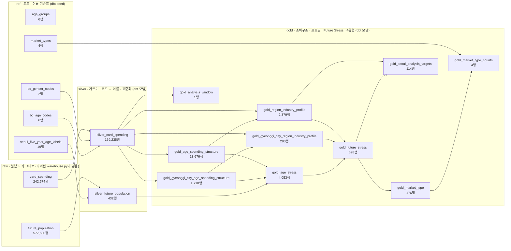
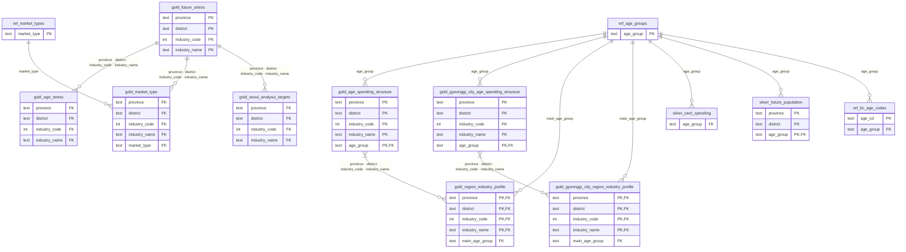

# 데이터 웨어하우스 데이터 사전

> **자동 생성 문서입니다. 손으로 고치지 마세요.** 만든 시각 2026-10-23 18:29 · `python -m future_stress.storage.warehouse_docs` (설명은 `dbt/models/*.yml` · `dbt/models/docs.md`에서 고칩니다)

PostgreSQL `future_stress` 데이터베이스의 스키마 · 표 · 열을 정리한 문서입니다. 원본이 어디서 왔는지는 [데이터 출처](../data_sources.md), 왜 이렇게 만들었는지는 [15 PostgreSQL](../notes/15_postgresql.md) · [16 dbt](../notes/16_dbt.md)에 있습니다.

## 1. 한눈에

| 스키마 | 표 | 종류 | 행 수 | 테스트 | 설명 |
|---|---|---|---:|---:|---|
| `raw` | [`card_spending`](#rawcard_spending) | 원본 (파이썬 적재) | 242,574 | 3 | BC카드 결제 원본 (공모전 제공 2026.01 ~ 06, 이후 배치마다 한 파일). 파일들을 합친 것(같은 달은 늦게 온 파일). CSV 그대로, 열 이름만 소문자. 개인이 아닌 결제(성별 3 · x) 포함 |
| `raw` | [`future_population`](#rawfuture_population) | 원본 (파이썬 적재) | 577,680 | 2 | 서울 · 부산 · 경기 장래인구 원본. 5세 · 1세 · 합계 행과 원본 표기 그대로, 연도 열만 세로로 |
| `ref` | [`age_groups`](#refage_groups) | 기준표 (seed) | 6 | 2 | 분석에서 쓰는 6개 연령대와 순서 |
| `ref` | [`bc_age_codes`](#refbc_age_codes) | 기준표 (seed) | 6 | 3 | BC카드 AGE_CD → 연령대. 이 표에 없는 코드(x 등)는 Silver에서 빠짐 |
| `ref` | [`bc_gender_codes`](#refbc_gender_codes) | 기준표 (seed) | 2 | 2 | BC카드 GENDER_CD → 성별. 이 표에 없는 코드(3 · x)는 개인이 아닌 결제라 Silver에서 빠짐 |
| `ref` | [`market_types`](#refmarket_types) | 기준표 (seed) | 4 | 2 | 4유형과 전략 방향 (diagnosis.MARKET_TYPE_STRATEGY와 같은 내용). 성장 여부 × Stress 2040 부호로 정함 |
| `ref` | [`seoul_five_year_age_labels`](#refseoul_five_year_age_labels) | 기준표 (seed) | 19 | 2 | 서울 장래인구에서 쓰는 5세 구간 표기 목록. 발표 결과 재현용으로 원래 노트북의 목록을 그대로 둡니다. 주의: 마지막 '90세 이상'은 원본 파일에 없는 표기라(실제는 '90~94세' · '95세 이상') 서울 90세 이상 인구가 빠집니다. (docs/refactoring_notes.md 4절, docs/notes/07) |
| `silver` | [`silver_card_spending`](#silversilver_card_spending) | dbt 모델 | 159,235 | 7 | 개인 결제만 남기고 코드를 이름으로 바꾼 BC카드 결제 (파이썬 Silver card_spending과 같은 내용) |
| `silver` | [`silver_future_population`](#silversilver_future_population) | dbt 모델 | 432 | 4 | 시도 × 시군구 × 연령대 장래인구와 2026년 대비 증감률 (파이썬 Silver future_population과 같은 내용) |
| `gold` | [`gold_age_spending_structure`](#goldgold_age_spending_structure) | dbt 모델 | 13,676 | 4 | 전국 시군구 × 업종 × 연령대 이용금액과 비중(%) (파이썬 Gold age_spending_structure) |
| `gold` | [`gold_age_stress`](#goldgold_age_stress) | dbt 모델 | 4,053 | 2 | 연령대별 Stress 기여도 · 서울 · 부산은 시군구, 경기는 시 단위 (파이썬 Gold age_stress) |
| `gold` | [`gold_analysis_window`](#goldgold_analysis_window) | dbt 모델 | 1 | 2 | 분석 기간 한 줄. raw 결제의 마지막 달에서 거꾸로 6개월이며, 새 달 원본이 오면 옮겨 감 (파이썬 Gold analysis_window) |
| `gold` | [`gold_future_stress`](#goldgold_future_stress) | dbt 모델 | 698 | 2 | 지역 × 업종 Future Stress 2035 · 2040 (파이썬 Gold future_stress). 서울 · 부산은 전국 프로필, 경기는 시 단위 프로필 |
| `gold` | [`gold_gyeonggi_city_age_spending_structure`](#goldgold_gyeonggi_city_age_spending_structure) | dbt 모델 | 1,710 | 2 | 경기 시 × 업종 × 연령대 이용금액과 비중(%) (일반구를 시로 합친 뒤 · 파이썬 Gold gyeonggi_city_age_spending_structure) |
| `gold` | [`gold_gyeonggi_city_region_industry_profile`](#goldgold_gyeonggi_city_region_industry_profile) | dbt 모델 | 293 | 3 | 경기 시 × 업종 한 건에 한 줄 (경기 Future Stress의 바탕) |
| `gold` | [`gold_market_type`](#goldgold_market_type) | dbt 모델 | 176 | 2 | 지역 안 상위 25% 분석 대상과 4유형 (파이썬 Gold market_type) |
| `gold` | [`gold_market_type_counts`](#goldgold_market_type_counts) | dbt 모델 | 4 | 2 | 지역별 4유형 건수 (한 건도 없는 유형도 0으로) |
| `gold` | [`gold_region_industry_profile`](#goldgold_region_industry_profile) | dbt 모델 | 2,379 | 3 | 전국 지역 × 업종 한 건에 한 줄 · 핵심 연령대, 연령 집중도, 현재 성장 지표 (파이썬 Gold region_industry_profile) |
| `gold` | [`gold_seoul_analysis_targets`](#goldgold_seoul_analysis_targets) | dbt 모델 | 114 | 1 | 발표 기준(전국 상위 25%) 서울 분석 대상과 성장 판정. 통계 검정은 파이썬이 이 대상으로 계산 |

표 19개 · 테스트 52개 (dbt build가 매번 모두 실행). 이 중 2개는 여러 표를 함께 보는 직접 만든 SQL 테스트(대사 등, `dbt/tests/`)입니다.

## 2. 계보 (lineage)

어느 표가 어느 표로 만들어지는지입니다. 화살표 방향으로 데이터가 흐릅니다. dbt가 SQL 안의 `ref()` · `source()`를 보고 알아낸 관계라서, 모델을 바꾸면 이 그림도 저절로 바뀝니다.

## 3. ERD (표 사이 연결)

선 하나 = 'dbt 테스트로 매번 확인하는 연결'입니다. `PK`는 겹치면 안 되는 열쇠(unique 테스트), `FK`는 다른 표에 반드시 있어야 하는 값(relationships 테스트)입니다. 여러 열을 합친 열쇠(시도 · 시군구 · 업종코드 · 업종명)는 직접 만든 `composite_relationships` 테스트로 확인합니다.

## 4. 표마다 열

### raw.card_spending

BC카드 결제 원본 (공모전 제공 2026.01 ~ 06, 이후 배치마다 한 파일). 파일들을 합친 것(같은 달은 늦게 온 파일). CSV 그대로, 열 이름만 소문자. 개인이 아닌 결제(성별 3 · x) 포함

행 242,574 · 테스트: not_null 2, 직접 만든 SQL 테스트 1

| 열 | 타입 | 설명 |
|---|---|---|
| `strd_yymm` | integer |  |
| `sido_nm` | text |  |
| `ccg_nm` | text |  |
| `gender_cd` | text |  |
| `age_cd` | text |  |
| `tp_buz_no` | text |  |
| `tp_buz_nm` | text |  |
| `amt` | bigint |  |
| `cnt` | bigint |  |
| `source_file` | text |  |

### raw.future_population

서울 · 부산 · 경기 장래인구 원본. 5세 · 1세 · 합계 행과 원본 표기 그대로, 연도 열만 세로로

행 577,680 · 테스트: accepted_values 1, not_null 1

| 열 | 타입 | 설명 |
|---|---|---|
| `source_file` | text |  |
| `province` | text |  |
| `region` | text |  |
| `sex` | text |  |
| `age_label` | text |  |
| `age_detail` | text |  |
| `year` | integer |  |
| `population` | bigint |  |

### ref.age_groups

분석에서 쓰는 6개 연령대와 순서

행 6 · 열쇠 `age_group` · 테스트: not_null 1, unique 1

| 열 | 타입 | 설명 |
|---|---|---|
| `age_group` | text |  |
| `sort_order` | integer |  |

### ref.bc_age_codes

BC카드 AGE_CD → 연령대. 이 표에 없는 코드(x 등)는 Silver에서 빠짐

행 6 · 열쇠 `age_cd` · 테스트: not_null 1, relationships 1, unique 1

| 열 | 타입 | 설명 |
|---|---|---|
| `age_cd` | text |  |
| `age_group` | text |  |

### ref.bc_gender_codes

BC카드 GENDER_CD → 성별. 이 표에 없는 코드(3 · x)는 개인이 아닌 결제라 Silver에서 빠짐

행 2 · 열쇠 `gender_cd` · 테스트: not_null 1, unique 1

| 열 | 타입 | 설명 |
|---|---|---|
| `gender_cd` | text |  |
| `sex` | text |  |

### ref.market_types

4유형과 전략 방향 (diagnosis.MARKET_TYPE_STRATEGY와 같은 내용). 성장 여부 × Stress 2040 부호로 정함

행 4 · 열쇠 `market_type` · 테스트: not_null 1, unique 1

| 열 | 타입 | 설명 |
|---|---|---|
| `market_type` | text |  |
| `strategy` | text |  |
| `sort_order` | integer |  |

### ref.seoul_five_year_age_labels

서울 장래인구에서 쓰는 5세 구간 표기 목록. 발표 결과 재현용으로 원래 노트북의 목록을 그대로 둡니다. 주의: 마지막 '90세 이상'은 원본 파일에 없는 표기라(실제는 '90~94세' · '95세 이상') 서울 90세 이상 인구가 빠집니다. (docs/refactoring_notes.md 4절, docs/notes/07)

행 19 · 열쇠 `age_label` · 테스트: not_null 1, unique 1

| 열 | 타입 | 설명 |
|---|---|---|
| `age_label` | text |  |

### silver.silver_card_spending

개인 결제만 남기고 코드를 이름으로 바꾼 BC카드 결제 (파이썬 Silver card_spending과 같은 내용)

행 159,235 · 테스트: accepted_values 1, not_null 5, relationships 1

| 열 | 타입 | 설명 |
|---|---|---|
| `base_month` | integer | 기준년월 (예: 202601) |
| `province` | text | 시도 이름 (서울특별시 · 부산광역시 · 경기도 …) |
| `district` | text | 시군구 이름. 서울 · 부산은 자치구, 경기는 표에 따라 일반구(예: 수원시 장안구) 또는 시(예: 수원시) |
| `sex` | text | 성별 (남성 · 여성). 원본 성별 코드 1 · 2를 바꾼 값 |
| `age_group` | text | 6개 연령대 중 하나 (20대이하 · 20대 · 30대 · 40대 · 50대 · 60대이상, 기준표 ref.age_groups) |
| `industry_code` | integer | BC카드 업종 코드 (예: 8001) |
| `industry_name` | text | 업종 이름. 원본의 공백을 지운 값 (예: '편 의 점' → '편의점') |
| `amount` | bigint | 이용금액 (원) |
| `payment_count` | bigint | 이용건수 |

### silver.silver_future_population

시도 × 시군구 × 연령대 장래인구와 2026년 대비 증감률 (파이썬 Silver future_population과 같은 내용)

행 432 · 열쇠 `province`, `district`, `age_group` · 테스트: not_null 2, relationships 1, unique_combination 1

| 열 | 타입 | 설명 |
|---|---|---|
| `province` | text | 시도 이름 (서울특별시 · 부산광역시 · 경기도 …) |
| `district` | text | 시군구 (경기는 시 단위) |
| `age_group` | text | 6개 연령대 중 하나 (20대이하 · 20대 · 30대 · 40대 · 50대 · 60대이상, 기준표 ref.age_groups) |
| `population_2026` | numeric | 그 해의 장래 추계 인구 (명) · 2026년 (기준연도) |
| `population_2030` | numeric | 그 해의 장래 추계 인구 (명) · 2030년 |
| `population_2035` | numeric | 그 해의 장래 추계 인구 (명) · 2035년 |
| `population_2040` | numeric | 그 해의 장래 추계 인구 (명) · 2040년 |
| `change_rate_2030` | double precision | 2026년 대비 그 해의 인구 증감률 (%), 소수 첫째 자리. 양수면 늘고 음수면 줄어듦 · 2030년 |
| `change_rate_2035` | double precision | 2026년 대비 그 해의 인구 증감률 (%), 소수 첫째 자리. 양수면 늘고 음수면 줄어듦 · 2035년 |
| `change_rate_2040` | double precision | 2026년 대비 그 해의 인구 증감률 (%), 소수 첫째 자리. 양수면 늘고 음수면 줄어듦 · 2040년 |

### gold.gold_age_spending_structure

전국 시군구 × 업종 × 연령대 이용금액과 비중(%) (파이썬 Gold age_spending_structure)

행 13,676 · 열쇠 `province`, `district`, `industry_code`, `industry_name`, `age_group` · 테스트: not_null 1, relationships 1, unique_combination 1, 직접 만든 SQL 테스트 1

| 열 | 타입 | 설명 |
|---|---|---|
| `province` | text | 시도 이름 (서울특별시 · 부산광역시 · 경기도 …) |
| `district` | text | 시군구 이름. 서울 · 부산은 자치구, 경기는 표에 따라 일반구(예: 수원시 장안구) 또는 시(예: 수원시) |
| `industry_code` | integer | BC카드 업종 코드 (예: 8001) |
| `industry_name` | text | 업종 이름. 원본의 공백을 지운 값 (예: '편 의 점' → '편의점') |
| `age_group` | text | 6개 연령대 중 하나 (20대이하 · 20대 · 30대 · 40대 · 50대 · 60대이상, 기준표 ref.age_groups) |
| `amount` | numeric | 이용금액 (원) · 6개월 합계 |
| `payment_count` | numeric | 이용건수 · 6개월 합계 |
| `industry_total_amount` | numeric | 같은 시도 · 시군구 · 업종의 6개월 전체 연령 이용금액 합계 (원). '상위 25%' 규모 기준에 씀 |
| `amount_share` | double precision | 이 연령대가 업종 이용금액에서 차지하는 비중 (%). 소수 첫째 자리, 파이썬과 같은 짝수 쪽 반올림. Future Stress 공식의 '연령별 이용금액 비중' |

### gold.gold_age_stress

연령대별 Stress 기여도 · 서울 · 부산은 시군구, 경기는 시 단위 (파이썬 Gold age_stress)

행 4,053 · 테스트: composite_relationships 1, not_null 1

| 열 | 타입 | 설명 |
|---|---|---|
| `province` | text | 시도 이름 (서울특별시 · 부산광역시 · 경기도 …) |
| `district` | text | 시군구 이름. 서울 · 부산은 자치구, 경기는 표에 따라 일반구(예: 수원시 장안구) 또는 시(예: 수원시) |
| `industry_code` | integer | BC카드 업종 코드 (예: 8001) |
| `industry_name` | text | 업종 이름. 원본의 공백을 지운 값 (예: '편 의 점' → '편의점') |
| `age_group` | text | 6개 연령대 중 하나 (20대이하 · 20대 · 30대 · 40대 · 50대 · 60대이상, 기준표 ref.age_groups) |
| `amount` | numeric | 이용금액 (원) · 6개월 합계 |
| `payment_count` | numeric | 이용건수 · 6개월 합계 |
| `industry_total_amount` | numeric | 같은 시도 · 시군구 · 업종의 6개월 전체 연령 이용금액 합계 (원). '상위 25%' 규모 기준에 씀 |
| `amount_share` | double precision | 이 연령대가 업종 이용금액에서 차지하는 비중 (%). 소수 첫째 자리, 파이썬과 같은 짝수 쪽 반올림. Future Stress 공식의 '연령별 이용금액 비중' |
| `change_rate_2030` | double precision | 2026년 대비 그 해의 인구 증감률 (%), 소수 첫째 자리. 양수면 늘고 음수면 줄어듦 · 2030년 |
| `change_rate_2035` | double precision | 2026년 대비 그 해의 인구 증감률 (%), 소수 첫째 자리. 양수면 늘고 음수면 줄어듦 · 2035년 |
| `change_rate_2040` | double precision | 2026년 대비 그 해의 인구 증감률 (%), 소수 첫째 자리. 양수면 늘고 음수면 줄어듦 · 2040년. 장래인구가 없는 시군구 · 연령대는 비어 Stress에서 빠짐 |
| `stress_2035` | double precision | 이 연령대의 Stress 기여도 = 비중 ÷ 100 × 인구 증감률. 지역 × 업종으로 더하면 Future Stress · 2035년 |
| `stress_2040` | double precision | 이 연령대의 Stress 기여도 = 비중 ÷ 100 × 인구 증감률. 지역 × 업종으로 더하면 Future Stress · 2040년 |

### gold.gold_analysis_window

분석 기간 한 줄. raw 결제의 마지막 달에서 거꾸로 6개월이며, 새 달 원본이 오면 옮겨 감 (파이썬 Gold analysis_window)

행 1 · 테스트: not_null 2

| 열 | 타입 | 설명 |
|---|---|---|
| `start_month` | integer | 분석 기간 첫 달 (예 202601) |
| `end_month` | integer | 분석 기간 마지막 달 = raw의 마지막 달 |
| `month_count` | integer | 분석 기간 개월 수 (6) |
| `months_with_payments` | bigint | 분석 기간 중 결제가 한 건이라도 있는 달 수. 6보다 작으면 통째로 빈 달이 있음 |

### gold.gold_future_stress

지역 × 업종 Future Stress 2035 · 2040 (파이썬 Gold future_stress). 서울 · 부산은 전국 프로필, 경기는 시 단위 프로필

행 698 · 열쇠 `province`, `district`, `industry_code`, `industry_name` · 테스트: not_null 1, unique_combination 1

| 열 | 타입 | 설명 |
|---|---|---|
| `province` | text | 시도 이름 (서울특별시 · 부산광역시 · 경기도 …) |
| `district` | text | 시군구 이름. 서울 · 부산은 자치구, 경기는 표에 따라 일반구(예: 수원시 장안구) 또는 시(예: 수원시) |
| `industry_code` | integer | BC카드 업종 코드 (예: 8001) |
| `industry_name` | text | 업종 이름. 원본의 공백을 지운 값 (예: '편 의 점' → '편의점') |
| `main_age_group` | text | 핵심 고객 연령대 = 이용금액 비중이 가장 큰 연령대 |
| `main_age_share` | double precision | 핵심 고객 연령대의 이용금액 비중 (%) |
| `industry_total_amount` | numeric | 같은 시도 · 시군구 · 업종의 6개월 전체 연령 이용금액 합계 (원). '상위 25%' 규모 기준에 씀 |
| `age_concentration` | double precision | 연령 집중도 HHI = Σ(비중)². 한 연령대에 몰릴수록 1에 가깝고, 6개에 고르게 퍼지면 1/6에 가까움 |
| `months_with_data` | bigint | 6개월 중 결제가 있었던 달 수 |
| `is_complete_6_months` | boolean | 6개월 모두 결제가 있었는지. 아니면 성장 지표를 비워 판정에서 뺌 |
| `avg_monthly_change` | double precision | 월평균 증감률 (%) = 전월 대비 증감률 5개의 평균, 소수 첫째 자리. 6개월 완전일 때만 |
| `change_first_to_last_month` | double precision | 1월 대비 6월 증감률 (%), 소수 첫째 자리. 6개월 완전일 때만 |
| `rising_months` | double precision | 전월보다 이용금액이 늘어난 달 수 (0 ~ 5). 6개월 완전일 때만 |
| `stress_2035` | double precision | Future Stress = Σ(연령별 이용금액 비중 × 그 연령대의 인구 증감률). 음수면 현재 고객 구성이 인구 감소에 노출(취약), 0 이상이면 안정 · 2035년 |
| `stress_2040` | double precision | Future Stress = Σ(연령별 이용금액 비중 × 그 연령대의 인구 증감률). 음수면 현재 고객 구성이 인구 감소에 노출(취약), 0 이상이면 안정 · 2040년 (4유형 기준) |

### gold.gold_gyeonggi_city_age_spending_structure

경기 시 × 업종 × 연령대 이용금액과 비중(%) (일반구를 시로 합친 뒤 · 파이썬 Gold gyeonggi_city_age_spending_structure)

행 1,710 · 열쇠 `province`, `district`, `industry_code`, `industry_name`, `age_group` · 테스트: relationships 1, unique_combination 1

| 열 | 타입 | 설명 |
|---|---|---|
| `province` | text | 시도 이름 (서울특별시 · 부산광역시 · 경기도 …) |
| `district` | text | 시 이름 (일반구를 합친 뒤) |
| `industry_code` | integer | BC카드 업종 코드 (예: 8001) |
| `industry_name` | text | 업종 이름. 원본의 공백을 지운 값 (예: '편 의 점' → '편의점') |
| `age_group` | text | 6개 연령대 중 하나 (20대이하 · 20대 · 30대 · 40대 · 50대 · 60대이상, 기준표 ref.age_groups) |
| `amount` | numeric | 이용금액 (원) · 6개월 합계 |
| `payment_count` | numeric | 이용건수 · 6개월 합계 |
| `industry_total_amount` | numeric | 같은 시도 · 시군구 · 업종의 6개월 전체 연령 이용금액 합계 (원). '상위 25%' 규모 기준에 씀 |
| `amount_share` | double precision | 이 연령대가 업종 이용금액에서 차지하는 비중 (%). 소수 첫째 자리, 파이썬과 같은 짝수 쪽 반올림. Future Stress 공식의 '연령별 이용금액 비중' |

### gold.gold_gyeonggi_city_region_industry_profile

경기 시 × 업종 한 건에 한 줄 (경기 Future Stress의 바탕)

행 293 · 열쇠 `province`, `district`, `industry_code`, `industry_name` · 테스트: composite_relationships 1, relationships 1, unique_combination 1

| 열 | 타입 | 설명 |
|---|---|---|
| `province` | text | 시도 이름 (서울특별시 · 부산광역시 · 경기도 …) |
| `district` | text | 시군구 이름. 서울 · 부산은 자치구, 경기는 표에 따라 일반구(예: 수원시 장안구) 또는 시(예: 수원시) |
| `industry_code` | integer | BC카드 업종 코드 (예: 8001) |
| `industry_name` | text | 업종 이름. 원본의 공백을 지운 값 (예: '편 의 점' → '편의점') |
| `main_age_group` | text | 핵심 고객 연령대 = 이용금액 비중이 가장 큰 연령대 |
| `main_age_share` | double precision | 핵심 고객 연령대의 이용금액 비중 (%) |
| `industry_total_amount` | numeric | 같은 시도 · 시군구 · 업종의 6개월 전체 연령 이용금액 합계 (원). '상위 25%' 규모 기준에 씀 |
| `age_concentration` | double precision | 연령 집중도 HHI = Σ(비중)². 한 연령대에 몰릴수록 1에 가깝고, 6개에 고르게 퍼지면 1/6에 가까움 |
| `months_with_data` | bigint | 6개월 중 결제가 있었던 달 수 |
| `is_complete_6_months` | boolean | 6개월 모두 결제가 있었는지. 아니면 성장 지표를 비워 판정에서 뺌 |
| `avg_monthly_change` | double precision | 월평균 증감률 (%) = 전월 대비 증감률 5개의 평균, 소수 첫째 자리. 6개월 완전일 때만 |
| `change_first_to_last_month` | double precision | 1월 대비 6월 증감률 (%), 소수 첫째 자리. 6개월 완전일 때만 |
| `rising_months` | double precision | 전월보다 이용금액이 늘어난 달 수 (0 ~ 5). 6개월 완전일 때만 |

### gold.gold_market_type

지역 안 상위 25% 분석 대상과 4유형 (파이썬 Gold market_type)

행 176 · 테스트: composite_relationships 1, relationships 1

| 열 | 타입 | 설명 |
|---|---|---|
| `province` | text |  |
| `district` | text |  |
| `industry_code` | integer |  |
| `industry_name` | text |  |
| `main_age_group` | text |  |
| `main_age_share` | double precision |  |
| `industry_total_amount` | numeric |  |
| `age_concentration` | double precision |  |
| `months_with_data` | bigint |  |
| `is_complete_6_months` | boolean |  |
| `avg_monthly_change` | double precision |  |
| `change_first_to_last_month` | double precision |  |
| `rising_months` | double precision |  |
| `stress_2035` | double precision |  |
| `stress_2040` | double precision |  |
| `size_cutoff` | double precision | 분석 대상 규모 기준 = 업종총이용금액의 75분위수 (상위 25%) · 그 지역 안 기준 |
| `is_growing` | boolean | 현재 성장 = 1→6월 증감률 > 0, 월평균 증감률 > 0, 오른 달 ≥ 3 을 모두 만족 |
| `is_stable_2040` | boolean | Stress 2040 ≥ 0 이면 안정 |
| `market_type` | text | 4유형: 착시성장형(성장 · 취약) · 지속성장형(성장 · 안정) · 구조취약형(비성장 · 취약) · 회복기회형(비성장 · 안정). Stress 2040 기준 |

### gold.gold_market_type_counts

지역별 4유형 건수 (한 건도 없는 유형도 0으로)

행 4 · 열쇠 `market_type` · 테스트: not_null 1, unique 1

| 열 | 타입 | 설명 |
|---|---|---|
| `market_type` | text | 4유형: 착시성장형(성장 · 취약) · 지속성장형(성장 · 안정) · 구조취약형(비성장 · 취약) · 회복기회형(비성장 · 안정). Stress 2040 기준 |
| `seoul` | bigint | 서울 건수 |
| `busan` | bigint | 부산 건수 |
| `gyeonggi` | bigint | 경기 건수 |

### gold.gold_region_industry_profile

전국 지역 × 업종 한 건에 한 줄 · 핵심 연령대, 연령 집중도, 현재 성장 지표 (파이썬 Gold region_industry_profile)

행 2,379 · 열쇠 `province`, `district`, `industry_code`, `industry_name` · 테스트: composite_relationships 1, relationships 1, unique_combination 1

| 열 | 타입 | 설명 |
|---|---|---|
| `province` | text | 시도 이름 (서울특별시 · 부산광역시 · 경기도 …) |
| `district` | text | 시군구 이름. 서울 · 부산은 자치구, 경기는 표에 따라 일반구(예: 수원시 장안구) 또는 시(예: 수원시) |
| `industry_code` | integer | BC카드 업종 코드 (예: 8001) |
| `industry_name` | text | 업종 이름. 원본의 공백을 지운 값 (예: '편 의 점' → '편의점') |
| `main_age_group` | text | 핵심 고객 연령대 = 이용금액 비중이 가장 큰 연령대 |
| `main_age_share` | double precision | 핵심 고객 연령대의 이용금액 비중 (%) |
| `industry_total_amount` | numeric | 같은 시도 · 시군구 · 업종의 6개월 전체 연령 이용금액 합계 (원). '상위 25%' 규모 기준에 씀 |
| `age_concentration` | double precision | 연령 집중도 HHI = Σ(비중)². 한 연령대에 몰릴수록 1에 가깝고, 6개에 고르게 퍼지면 1/6에 가까움 |
| `months_with_data` | bigint | 6개월 중 결제가 있었던 달 수 |
| `is_complete_6_months` | boolean | 6개월 모두 결제가 있었는지. 아니면 성장 지표를 비워 판정에서 뺌 |
| `avg_monthly_change` | double precision | 월평균 증감률 (%) = 전월 대비 증감률 5개의 평균, 소수 첫째 자리. 6개월 완전일 때만 |
| `change_first_to_last_month` | double precision | 1월 대비 6월 증감률 (%), 소수 첫째 자리. 6개월 완전일 때만 |
| `rising_months` | double precision | 전월보다 이용금액이 늘어난 달 수 (0 ~ 5). 6개월 완전일 때만 |

### gold.gold_seoul_analysis_targets

발표 기준(전국 상위 25%) 서울 분석 대상과 성장 판정. 통계 검정은 파이썬이 이 대상으로 계산

행 114 · 테스트: composite_relationships 1

| 열 | 타입 | 설명 |
|---|---|---|
| `province` | text |  |
| `district` | text |  |
| `industry_code` | integer |  |
| `industry_name` | text |  |
| `main_age_group` | text |  |
| `main_age_share` | double precision |  |
| `industry_total_amount` | numeric |  |
| `age_concentration` | double precision |  |
| `months_with_data` | bigint |  |
| `is_complete_6_months` | boolean |  |
| `avg_monthly_change` | double precision |  |
| `change_first_to_last_month` | double precision |  |
| `rising_months` | double precision |  |
| `stress_2035` | double precision |  |
| `stress_2040` | double precision |  |
| `size_cutoff` | double precision | 분석 대상 규모 기준 = 업종총이용금액의 75분위수 (상위 25%) · 전국 기준 |
| `is_growing` | boolean | 현재 성장 = 1→6월 증감률 > 0, 월평균 증감률 > 0, 오른 달 ≥ 3 을 모두 만족 |
